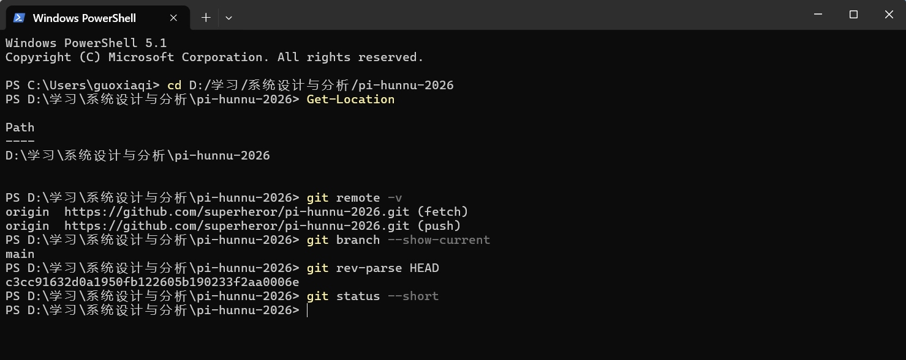

# 实践课2：组织建仓与 Pi Agent 源码分析 

- 姓名 郭夏琪
- 小组组织：superheror
- 小组代码仓库：https://github.com/orgs/superheror/repositories
- 实际 clone 地址：https://github.com/superheror/pi-hunnu-2026.git

## 任务一与任务二：建仓与源码获取

### 1. 仓库归属确认
本小组已成功将课程仓库 Fork 至小组 Organization 下。我作为组员，确认已加入组织并拥有开发权限，从小组组织仓库下载源码。

### 2. 本地下载与状态确认
在本地全英文路径下执行了 `git clone` 命令，并检查了本地状态：
*   `git remote -v`：`origin` 指向本小组的组织仓库地址。
*   `git branch --show-current`：当前位于 `main` 分支。
*   `git rev-parse HEAD`：当前提交编号为 `957c0c49b6e957deb548a19691f7bcff57a12122`。
*   `git status --short`：工作区干净。

> 

---

## 任务三：分析子模块功能与依赖关系

### 1.项目的构建顺序

项目的构建顺序为：telemetry → schema → chord → tui → codemode → mcp → ai → durable → env → agent → coding-agent。

这个顺序与模块的层级依赖关系紧密相连。构建脚本使用 && 将命令串联，要求必须在前一个模块编译成功并生成产物（如 dist 目录下的 JS 和类型声明文件）后，才能进行下一个模块的编译。这是因为在 Monorepo 架构中，上层的包会直接引用底层包的输出。因此，构建顺序本质上必须遵循“基础层 → 核心服务层 → 应用逻辑层 → 表现与入口层”的拓扑排序，任何底层模块的缺失都会导致上层模块编译失败。然而，相邻构建的模块并不一定代表它们在代码上互相依赖。例如排在前两位的 telemetry 和 schema，它们在业务逻辑上是相互独立的平行基础模块。之所以被安排相邻构建，仅仅是为了在执行调度时，先将所有不依赖内部其他业务模块的基础包集中处理完毕，为后续依赖它们的核心包扫清编译障碍。

### 2. 模块分析表

通过阅读根目录 `package.json` 的 `scripts.build` 字段（内容为依次 `cd` 进入各包并执行 `npm run build`），我提取出了构建顺序。结合各模块源代码和 `package.json`，分析如下：

| 子文件夹 | 代码主要实现什么功能 | 本模块 build 执行什么、生成什么 | 直接依赖哪些内部模块 | 依据文件或代码位置 |
| :--- | :--- | :--- | :--- | :--- |
| **telemetry** | 遥测与指标收集，记录使用数据和错误日志。 | 编译 TS 代码，生成 `dist` 目录下的 JS 文件。 | 无 | `packages/telemetry/package.json` |
| **schema** | 定义全局数据结构与类型验证模式。 | 编译 TS 代码，产出类型定义（`.d.ts`）。 | 无 | `packages/schema/package.json` |
| **chord** | 核心消息分发与协调通信逻辑。 | 编译 TS 代码。 | schema | `packages/chord/package.json` |
| **tui** | Terminal UI，负责命令行界面渲染和输入处理。 | 编译 TS 代码（可能有 native 编译脚本），生成界面组件。 | schema, chord | `packages/tui/package.json` |
| **codemode** | 代码模式处理，代码高亮与编辑交互。 | 编译 TS 代码。 | tui, schema | `packages/codemode/package.json` |
| **mcp** | Model Context Protocol 实现，连接外部工具。 | 编译 TS 代码。 | schema | `packages/mcp/package.json` |
| **ai** | 模型交互核心，封装大模型 API 调用、流式处理。 | 编译 TS 并执行 `generate-models` 拉取模型目录。 | schema | `packages/ai/package.json` |
| **durable** | 持久化状态管理，负责会话存储。 | 编译 TS 代码。 | schema | `packages/durable/package.json` |
| **env** | 环境上下文管理，封装系统变量和工作目录。 | 编译 TS 代码。 | 无 | `packages/env/package.json` |
| **agent** | 核心 Agent 逻辑，串联大模型、环境、工具。 | 编译 TS 代码。 | ai, env, durable, telemetry | `packages/agent/package.json` |
| **coding-agent** | CLI 入口包，集成所有底层模块，提供最终命令行工具。 | 使用 esbuild 打包为 `dist/bundle/cli.js`，配置 `bin`。 | agent, tui, mcp, codemode | `packages/coding-agent/package.json` |

---

### 3. 模块层级与依赖关系图

**层级划分依据：**
*   **基础层（Base）：** 不依赖或极少依赖内部模块，提供底层数据结构、环境信息、遥测。
*   **核心服务层（Core）：** 依赖基础层，提供领域核心能力（AI 通信、MCP、存储、通信协调）。
*   **应用逻辑层（Logic）：** 串联核心服务，提供 Agent 的思考与执行逻辑。
*   **表现与入口层（Presentation）：** 负责用户界面展示和最终打包产出。

**依赖关系图（Mermaid，箭头方向为“使用方 → 被依赖方”）：**

---

### 4. 问答分析
**Q1：根目录与子模块中的 npm run build 分别读取什么配置、执行什么工作？**

根目录： 读取根 package.json 的 scripts.build。它实际上是一个“构建调度器”，通过 && 串联，依次 cd 进入各子包目录并执行 npm run build。

子模块： 读取该子包自身的 package.json。通常执行 tsc（TypeScript 编译器）编译源码，或者使用 esbuild 等打包工具生成 bundle，产物输出到各自包的 dist 目录中。

**Q2：构建顺序和模块依赖有什么关系？相邻构建的模块是否一定互相依赖？**

关系： 构建顺序必须遵循依赖拓扑顺序。被依赖的底层模块（如 schema）必须先于依赖它的上层模块（如 ai、agent）构建，否则上层模块在编译时会找不到类型声明而报错。

相邻不一定依赖： 例如按根脚本，telemetry 和 schema 是相邻构建的，但从代码依赖看，二者属于平行基础模块，telemetry 并不依赖 schema。这种相邻只是为了让构建脚本有条理地覆盖所有包。

**Q3：选择一条涉及至少三个模块的依赖路径，说明这些模块如何分工。**

依赖路径： coding-agent → agent → ai → schema

---

schema 定义基础数据结构和接口，比如消息体格式。
ai 依赖 schema，实现与大模型 API 的网络请求、流式响应解析。
agent 依赖 ai 与 env，构建 Agent 的思考循环，将用户输入传给 ai，并根据返回值决定下一步动作。
coding-agent 作为最终 CLI 入口，打包并整合 agent、tui、mcp 等模块，向用户暴露 pi 命令。
