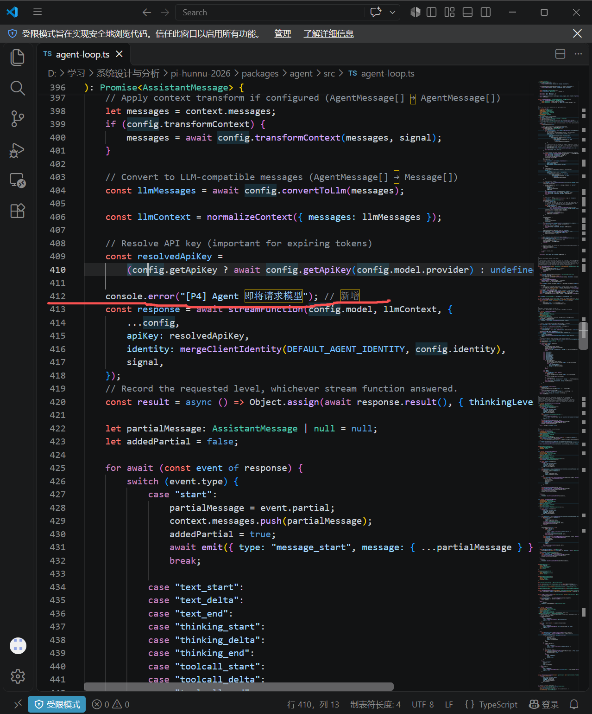
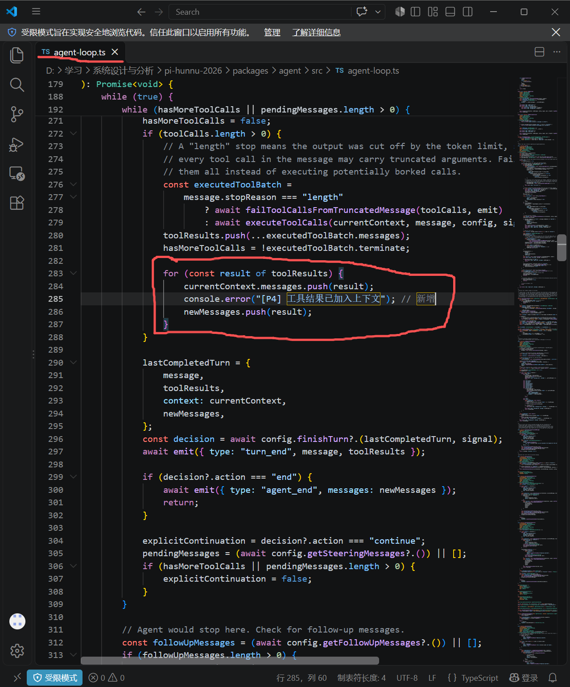
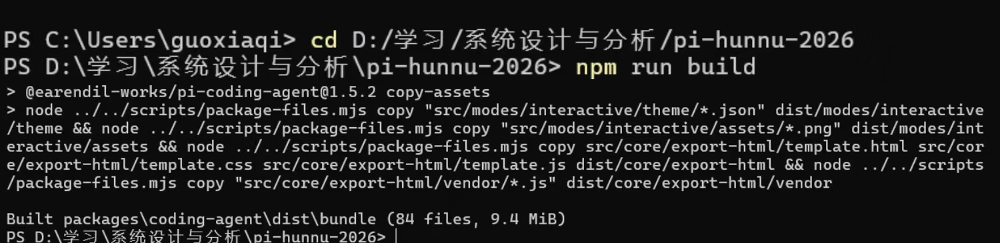
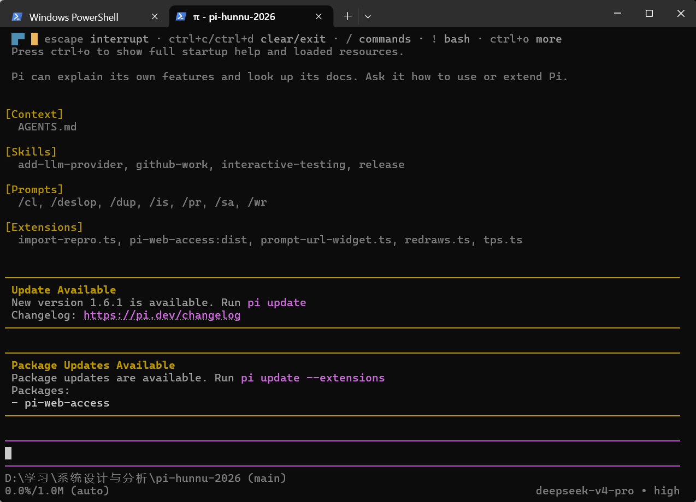
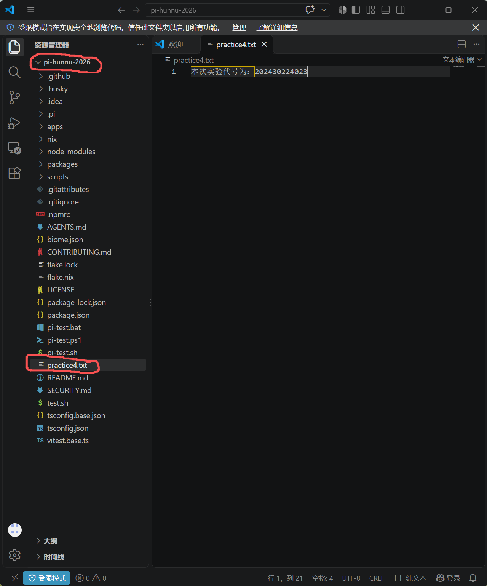
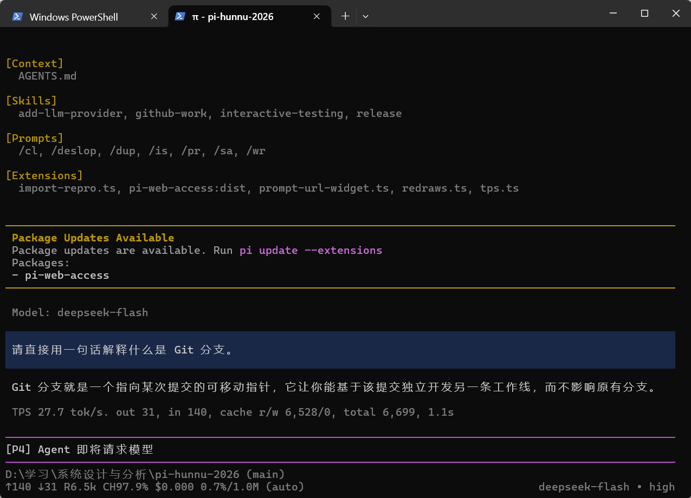
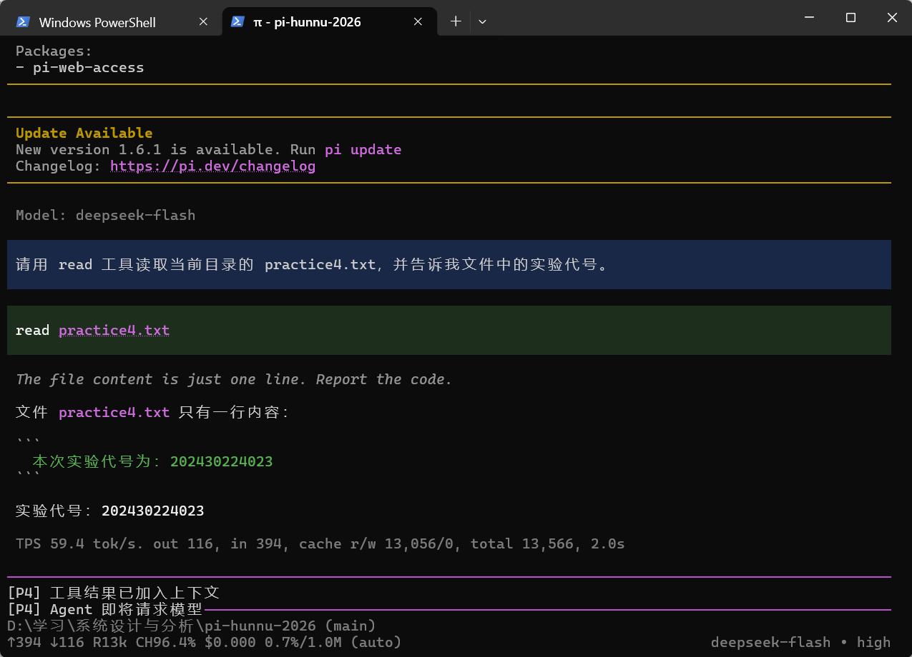
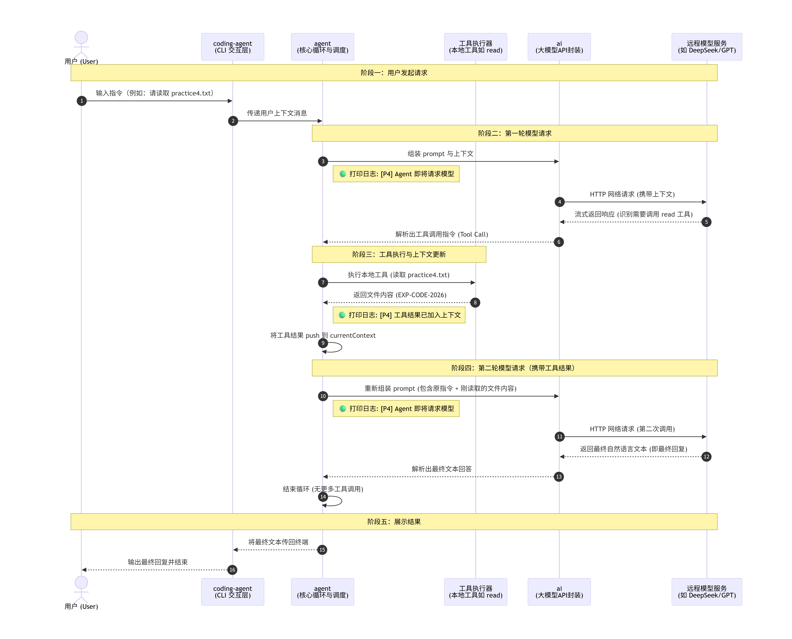

# 实践课4：Pi Agent 模型调用与运行流程 实验报告

**姓名：** 郭夏琪
**GitHub账号：** qiqi341
**小组代码仓库：** https://github.com/orgs/superheror/repositories
**个人作业仓库：** https://github.com/qiqi341/my-docs/new/main/report

---

## 任务一：给 Agent 循环加两行日志

根据任务要求，在 `packages/agent/src/agent-loop.ts` 源码中两处关键位置插入了日志打印代码，用于观察模型请求时机和上下文变化。

### 1. 模型调用前日志
在模型调用函数上方，插入了第一类日志。
**修改代码位置：** 
搜索 `const response = await streamFunction(config.model, llmContext, {`，在它上方新增。

` console.error("[P4] Agent 即将请求模型"); // 新增日志`

`const response = await streamFunction(config.model, llmContext, {`

`    // ... 原有参数代码`

> 

### 2. 工具结果加入上下文后日志
在将工具结果推入上下文消息数组后，插入了第二类日志，确保每次循环写入都会打印。
**修改代码位置：** 搜索 for (const result of toolResults) { 循环内的 currentContext.messages.push(result);，在它下方新增。

` for (const result of toolResults) {`
    `currentContext.messages.push(result);`
    `console.error("[P4] 工具结果已加入上下文"); // 新增日志`
    `newMessages.push(result);`
`}`

> 

---

## 任务二：重新编译与启动

### 1. 重新编译
源码保存后，在项目根目录执行构建命令：

npm run build

构建过程成功结束，无报错。

验证构建退出码，确认构建成功：

$LASTEXITCODE
输出：0

> 

### 2. 启动编译产物
使用 Node.js 启动构建后的 CLI 入口文件：

`node .\packages\coding-agent\dist\cli.js`

启动成功，进入 Pi 交互界面，同时终端会有 `[P4]` 日志输出。

> 
> 

---

## 任务三：对比两次运行

在本地根目录创建了文件 `practice4.txt`，内容写入本次实验代号：`[填入你的实验代号，如 EXP-CODE-2026]`。

### 会话 A：直接问答
使用同一模型，新开会话，输入指令：

> 请直接用一句话解释什么是 Git 分支。

**观察记录：**
*   **是否调用工具：** 否，模型直接凭知识回答。
*   **日志记录（按出现顺序）：**
    1. `[P4] Agent 即将请求模型`
*   **模型轮次：** 仅进入 **1 轮** 模型调用。
*   **最终回复：** `[填入模型实际生成的回复内容]`
*   **分析：** 因为不需要读取外部信息，Agent 把用户输入构造为上下文后，直接请求一次模型就得到了最终回答，没有触发工具循环。

>
> 

### 会话 B：读取文件
使用同一模型，另开新会话（确保上下文清空），输入指令：

> 请用 read 工具读取当前目录的 practice4.txt，并告诉我文件中的实验代号。

**观察记录：**
*   **是否调用工具：** 是，调用了 `read` 工具。
*   **实际读取结果：** Pi 成功读取到了文件，并返回了实验代号。
*   **日志记录（按出现顺序）：**
    1. `[P4] Agent 即将请求模型`
    2. `[P4] 工具结果已加入上下文`
    3. `[P4] Agent 即将请求模型`
*   **模型轮次：** 共进入 **2 轮** 模型调用。
*   **最终回复：** `[填入模型实际生成的回复内容]`

> 

#### 运行流程深度解析（结合会话 B 日志）：
1.  **谁实际读了文件？** 是本地的 **工具执行器（Tool Executor）**，而不是大模型。大模型本身运行在远程服务端，无法直接访问本地文件系统。模型在第一轮响应时，判断需要调用 `read` 工具，于是返回了工具调用指令；Pi 的本地程序解析到指令后，执行了真实的文件读取动作，并拿到了结果。
2.  **下一轮模型请求多带了什么？** 下一轮请求（第二次 `[P4] Agent 即将请求模型`）的上下文中，**多带了刚读取到的文件内容（工具结果 `result`）**。底层逻辑是通过 `currentContext.messages.push(result)` 将工具的输出追加到了对话历史中，模型在第二轮请求时，看到了上一轮工具调用的结果，从而能够基于该内容生成最终回复。

---

## 总结

通过本次实验，我直观地验证了 Agent 的运行机制：**大模型只负责“思考”和“决策”（返回工具调用意图），真正执行操作（如读文件）的是本地程序。** 多出来的“即将请求模型”日志，正是大模型带着本地工具执行结果再次进行推理的过程。这正是 Agent 区别于普通聊天机器人的核心机制——拥有调用工具并利用结果继续推理的能力。
